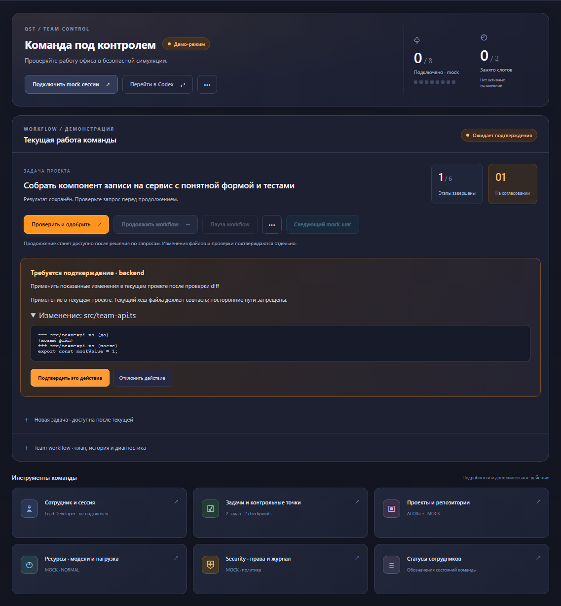

# Team control cards

The controls below the office are now organized around frequent actions. The office scene, eight employees, character assets and animations are unchanged.

The first card shows connection mode, connected employees, occupied execution slots and the existing connection controls. The workflow card shows the selected objective, actual completed/total stages, pending requests and the existing continue/pause actions. An unfinished workflow is initially selected ahead of cancelled history; the history selector remains available.

“Проверить и одобрить” only reveals and focuses the saved request, expanding its diff for inspection. The existing exact confirmation button performs approval. Pending requests keep continuation disabled, consistent with the engine's existing rule. File approval and test approval remain separate. Unavailable QA is displayed from the existing executor snapshot. Cancellation and disconnection remain accessible in the respective overflow menus.

New task creation, historical results, plans, repair/recovery controls and diagnostics remain available in disclosures. Six tool cards expose employee sessions, tasks/checkpoints, projects/repositories, resources, security and the status legend. Expanded tool cards use the full content width. Layout is checked at 1440 and 390 pixels with keyboard-focus styles and reduced-motion support.

All commands retain their existing client/controller, scopes, permission checks and contracts. This change does not alter server scheduling, Codex integration, model selection, task state, QA execution or project files. The Mock demonstration workflow is retained inside the employee/session tool.

Validation:

- Production TypeScript/Vite build passed.
- Fresh-browser Mock scenarios verify review without implicit approval, exact diff visibility, explicit approval, resume/pause, separate QA consent, tool access, reload preservation and the empty/task-creation state.
- Recovery/offline browser scenarios still pass after updating their selectors to the new presentation.
- The actual ArmGarage UI was inspected using GET-only requests: its principal workflow remains paused, approvals/results/history unchanged, no QA execution ID and no active employees.
- All 30 ready project/configuration files and 18 project journal files still match the stopped deployment backup.
- No real Codex tasks, project tests or file applications were performed for UI validation. Existing stabilization-suite acceptance remains recorded separately; unchanged backend tests were not rerun for this presentation change.

Full local logs and actual-workflow screenshots remain in ignored `work/deployment/` and `work/control-cards/`. Sanitized results are in `CONTROL_CARDS_EVIDENCE.json`. The following preview uses synthetic Mock data, not the user's live task:

